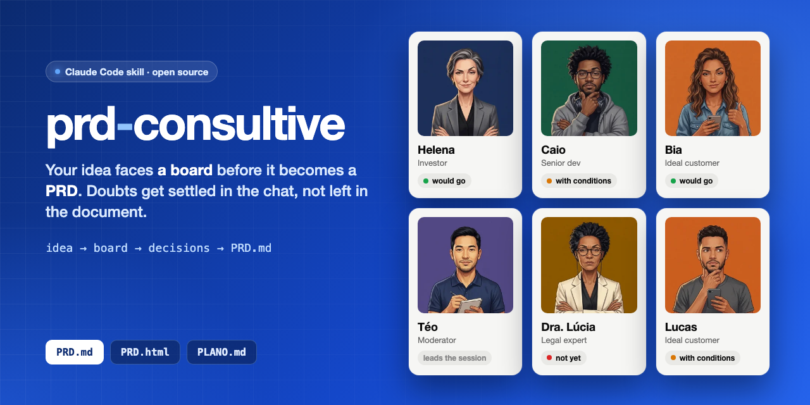
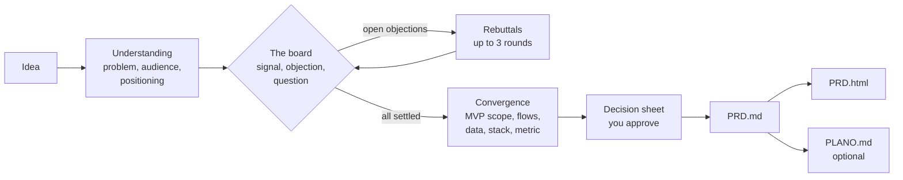
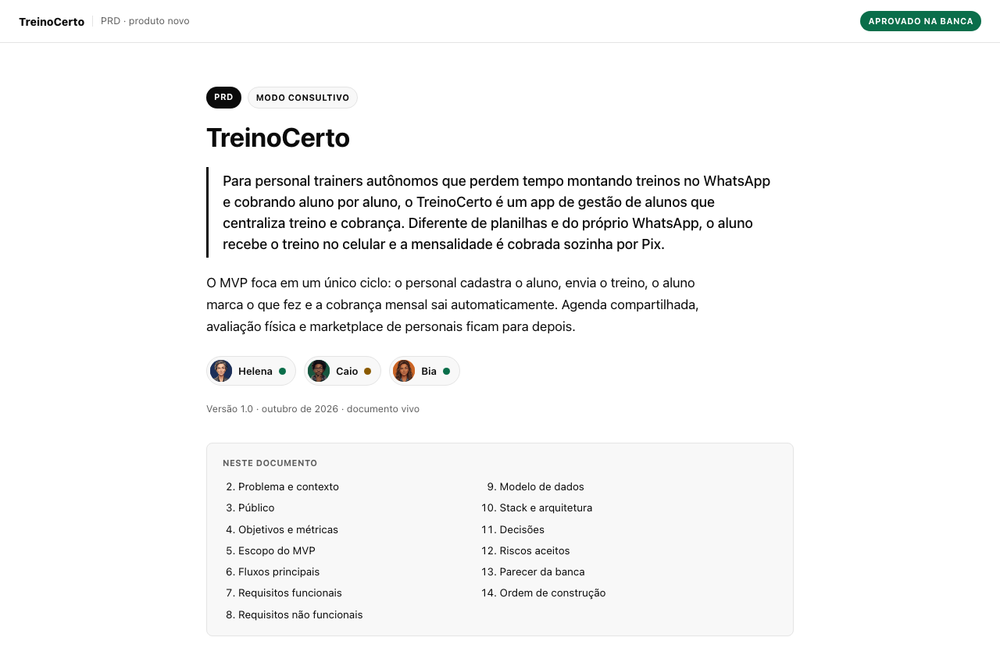
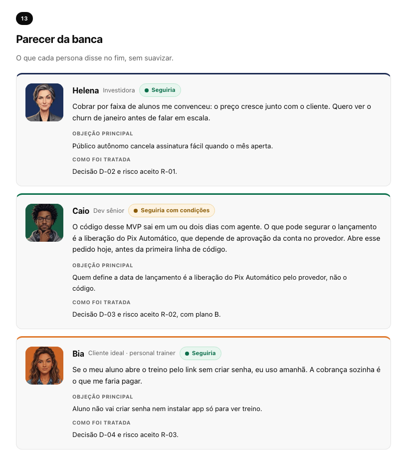

<p align="center">
  <a href="README.md"></a>
  <a href="README.pt-BR.md"></a>
</p>

<p align="center">
  
</p>

<p align="center">
  <a href="#install"></a>
  <a href="#starter-prompt"></a>
</p>

<p align="center">
  
  
  
  
</p>

# prd-consultive

**A Claude skill that writes PRDs the consultative way: before any document exists, a board of personas questions
your idea in the chat. Only when no doubt is left does it write the PRD, ready for Claude Code, Cursor or any other
coding agent.**

Coding agents don't ask when a spec is vague. They fill the gap with a plausible guess and build on top of it with
full confidence. Most PRD templates make this worse: they end with a list of "open questions" that nobody answers
before the agent starts.

This skill flips the order. An investor, a senior dev, your ideal customer, a moderator and, when the topic calls for
it, a legal expert push on the idea first. Every doubt ends as a **decision**, a **scope change** or an **accepted
risk**. The PRD records decisions, not questions.

---

## Contents

- [How it works](#how-it-works)
- [The board](#the-board)
- [Two modes](#two-modes)
- [What you get](#what-you-get)
- [Install](#install)
- [Starter prompt](#starter-prompt)
- [What happens after you press Enter](#what-happens-after-you-press-enter)
- [Your profile](#your-profile)
- [Language and country](#language-and-country)
- [Example](#example)
- [Make your own board](#make-your-own-board)
- [FAQ](#faq)
- [Contributing](#contributing)

---

## How it works



Nothing is written to a file until you approve the **decision sheet**: positioning, what's in and out of the MVP,
stack, success metric, decisions, accepted risks and the assumptions the skill made on its own, so you can correct
them.

## The board

<p>
  
  
  
  
  
  
</p>

| Who | What they want to know |
|---|---|
| **Helena**, investor | Who pays, how much, and what stops someone from copying you in a day |
| **Caio**, senior dev | The riskiest part, what to cut from the MVP, what depends on third parties |
| **Bia** or **Lucas**, ideal customer | Would I use it? Why would I switch from what I do today? |
| **Téo**, moderator | Runs the session, keeps the objection board, turns debates into decisions |
| **Dra. Lúcia**, legal expert | Joins when the idea touches sensitive data, money, regulated sectors or AI decisions |

Every persona gives a signal (🟢 would go, 🟡 with conditions, 🔴 not yet), their strongest objection and one
question. Each one has a history, a way of talking and blind spots that the others balance out, so they disagree
with each other the way a real board does. A signal only changes with an argument or evidence, never because you
insisted. Nobody says just "great idea".

The ideal customer adapts to your audience: if the product is for personal trainers, Bia is a personal trainer.

## Two modes

| | Fast mode | Consultative mode |
|---|---|---|
| For | You've done the research and just want the document | You have an idea and want to know if it holds up |
| What happens | One round of blocking gaps, a lightning opinion from the board, decision sheet, done | Understanding, full board with rebuttals, convergence, verdict, decision sheet |
| Typical length | 2 to 4 messages | 8 to 15 messages |

You control the pace at any time: *"speed up"*, *"I want to hear only Helena"*, *"go back, I changed my mind about
pricing"*.

## What you get

| File | For | What's inside |
|---|---|---|
| `PRD.md` | Your coding agent | Stable IDs (RF-01, D-01, R-01), testable acceptance criteria, decisions with the why and the rejected alternative, an explicit **out of scope** list |
| `PRD.html` | Reading and sharing | The same content as a clean, self-contained document, with the board's verdict and photos |
| `PLANO.md` | Building | Phases in dependency order, small tasks with "done when" checklists and a handoff prompt to paste into the agent |

Timelines are realistic for building with AI: code takes hours or days, never weeks. What usually sets the launch date
is waiting on third parties (payment provider approval, official API access, app store review), so those requests
become task `T-00`, started on day one in parallel.

## Install

**Requirements:** [Claude Code](https://claude.com/claude-code) (CLI, desktop app or IDE extension) or a claude.ai
plan with skills. Python 3 is optional (it embeds the board photos in the HTML).

### Option 1: Claude Code plugin (recommended)

Inside Claude Code:

```text
/plugin marketplace add JefersonMarcioEspindola/skill-prd-consultive
/plugin install prd-consultive@prd-consultive
```

Restart Claude Code if it asks. Update later with `/plugin marketplace update prd-consultive`.

### Option 2: skills CLI

```bash
npx skills add JefersonMarcioEspindola/skill-prd-consultive
```

### Option 3: manual

```bash
git clone https://github.com/JefersonMarcioEspindola/skill-prd-consultive.git
mkdir -p ~/.claude/skills
cp -R skill-prd-consultive/plugins/prd-consultive/skills/prd-consultive ~/.claude/skills/
```

### claude.ai

Zip the folder `plugins/prd-consultive/skills/prd-consultive` and upload it in Settings → Capabilities → Skills.

## Starter prompt

Open Claude Code in the folder where you want the documents (or the repo of an existing product) and paste:

```text
Use the prd-consultive skill. Put this idea in front of the board:

Idea: <one or two sentences, e.g. "an app for personal trainers to send workouts and collect monthly fees">
Who it's for: <as specific as you can, or "not sure yet">
Mode: <consultative / fast / you choose>
Stack: <your preference, "use what's in this repo", or "recommend one">

I also want the PLANO.md with tasks at the end.
```

Or just talk naturally. These work too:

> I want to write a PRD for a booking app for barbershops.

> Put this idea in front of the board: a SaaS that generates freelance contracts with AI.

## What happens after you press Enter

| Phase | What happens | You get |
|---|---|---|
| 0. Triage | Document type (new product, feature, technical) and mode | One line on how it works |
| 1. Understanding | Téo asks about problem, audience, current alternative, why now | A positioning sentence to confirm |
| 2. Board, round 1 | Each persona: signal, short take, main objection, one question | The objection board and up to 4 prioritized questions, with options |
| 3. Rebuttals | Only who has something new reacts; signals change with arguments | Every objection decided, cut or accepted as a risk |
| 4. Convergence | Each topic has an owner: scope (Caio), flows (Bia), metric (Helena), legal (Lúcia) | MVP in and out, flows, data, stack, success metric |
| 5. Verdict and gate | Final signals and the decision sheet | Your explicit yes before anything is written |
| 6. Generation | `PRD.md`, then `PRD.html`, then `PLANO.md` if you asked | Files saved, plus the next concrete step |

In consultative mode the skill keeps an `ideia.md` log in the output folder, so no decision gets lost if the
conversation is long or the context is summarized.

## Your profile

Fill in a profile once and the skill stops asking what it already knows: language, country, preferred stack, HTML
theme (light, dark or your brand colors), writing tone and output folder.

If you installed manually:

```bash
mkdir -p ~/.claude/prd-consultive
cp ~/.claude/skills/prd-consultive/perfil.md ~/.claude/prd-consultive/perfil.md
```

Edit the copy in `~/.claude/prd-consultive/`. That location survives plugin updates; the skill looks there first and
falls back to the template inside the skill folder. If you installed it as a plugin, the template lives in the plugin
folder: ask Claude to *"set up my prd-consultive profile"* and it will create the copy for you.

## Language and country

The skill's instructions are written in Brazilian Portuguese, but the board speaks **your** language: it answers in
the language you write in (or the one set in your profile) and writes the documents in it too. Local references
adapt to your country: GDPR or CCPA instead of LGPD, your payment methods, your currency. The personas keep their
names.

## Example

A full PRD for **TreinoCerto**, a fictional app for personal trainers, generated in consultative mode (in
Portuguese): [`docs/exemplo/PRD.md`](docs/exemplo/PRD.md) and [`docs/exemplo/PRD.html`](docs/exemplo/PRD.html)
(download it and open it in a browser).

<p align="center">
  
  
</p>

## Make your own board

The photos live in `plugins/prd-consultive/skills/prd-consultive/assets/banca/`, one per persona and signal
(`helena-neutro.webp`, `helena-verde.webp`, `helena-amarelo.webp`, `helena-vermelho.webp`...). Replace them with your
own, keeping the file names. The [`LEIA-ME.md`](plugins/prd-consultive/skills/prd-consultive/assets/banca/LEIA-ME.md)
in that folder has the sizes, background colors and a tip for generating a consistent set. Without photos the cards
fall back to colored initials.

## FAQ

**Is this just a PRD template?** No. The template is the last step. The value is in the questions that come before:
the board exists to find the weak spot while changing course is still cheap.

**Will it flatter my idea?** It's designed not to. Every persona must state an objection even when they're green,
praise has to be specific, signals only move with arguments, and two or more reds are reported plainly, with options
(pivot the audience, cut scope, validate first). You still decide.

**Does it make up market numbers?** No. Market size, competitor prices and conversion rates only appear with a source
(it searches when it has a search tool) or marked as a hypothesis to validate.

**Does it work in Cursor, Codex or other agents?** The skill is a plain `SKILL.md` with reference files, so agents
that support the skills format can load it. It's built and tested on Claude Code and claude.ai. The `PRD.md` it
produces works with any agent.

**Can I use it for a feature or a refactor, not a new product?** Yes. The board adapts: for a feature Helena talks
about business impact instead of market, and for a technical change Caio leads and the PRD gains a migration and
rollback plan.

## Contributing

Issues and PRs are welcome, especially new persona questions, better objections, and templates for other document
types. If the board let a bad idea through, or blocked a good one, open an issue with the conversation: that's how
the personas get sharper.

## License

[MIT](LICENSE) © Jeferson Marcio Espindola
