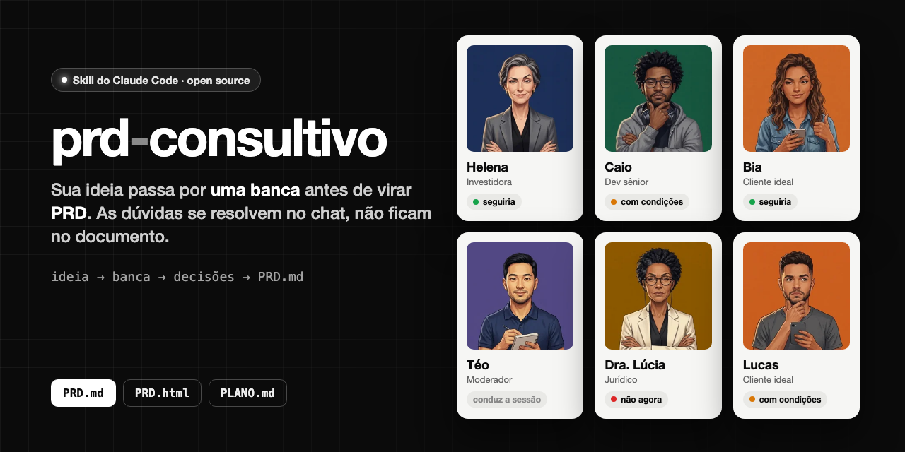
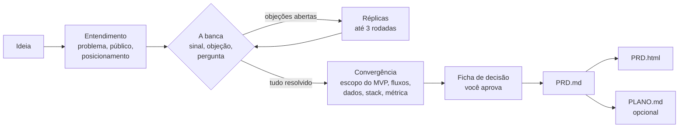
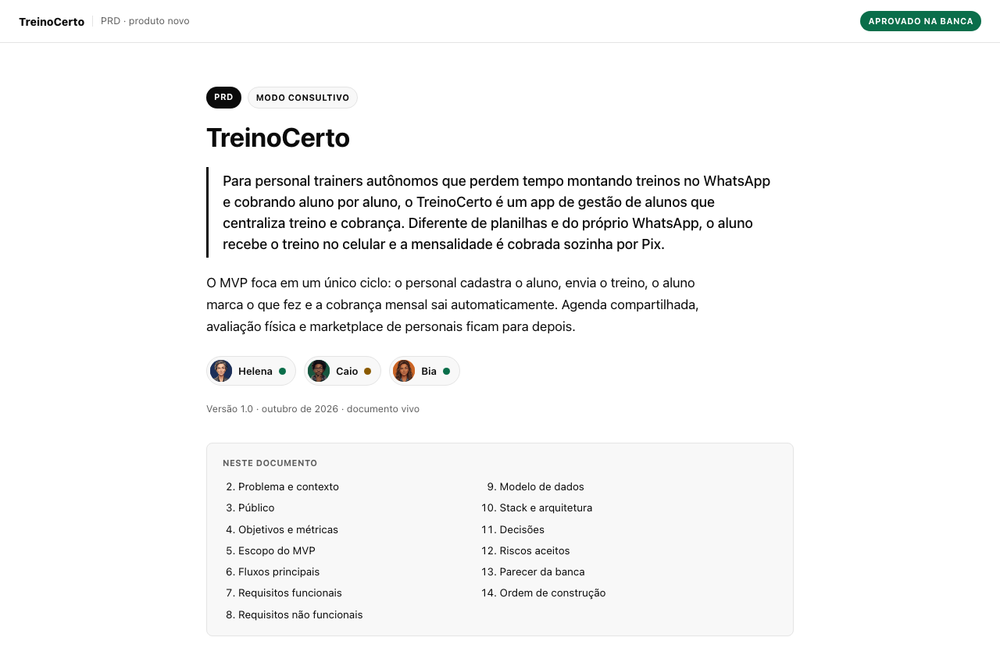
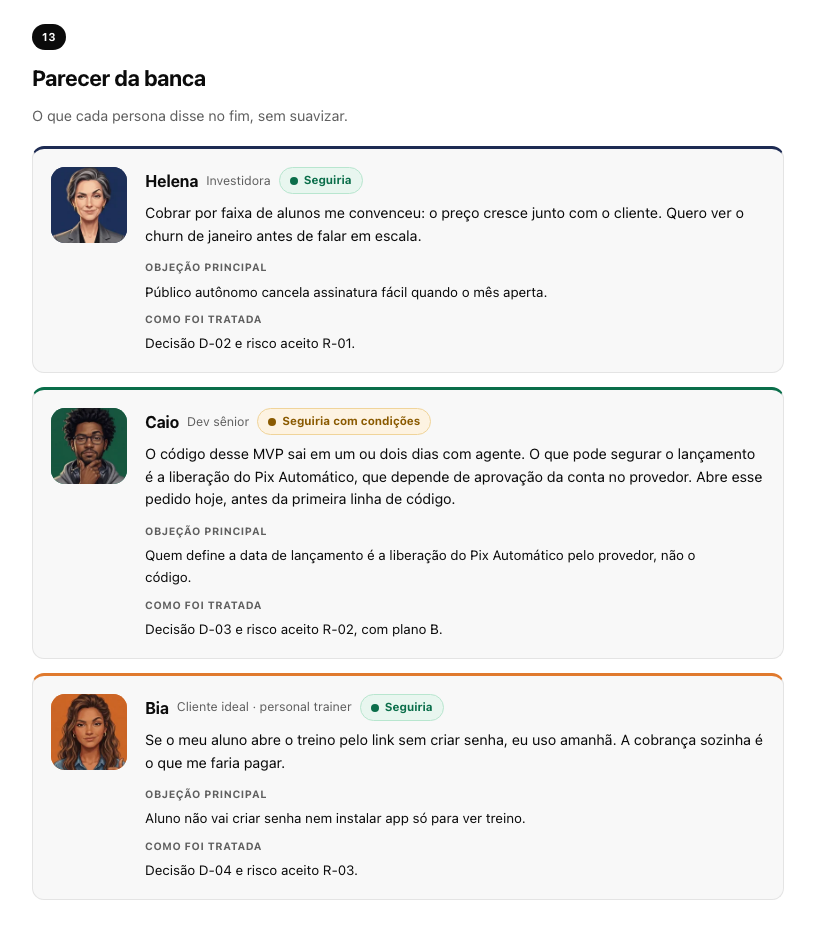

<p align="center">
  <a href="README.md"></a>
  <a href="README.pt-BR.md"></a>
</p>

<p align="center">
  
</p>

<p align="center">
  <a href="#instalação"></a>
  <a href="#prompt-inicial"></a>
</p>

<p align="center">
  
  
  
  
</p>

# prd-consultivo

**Uma skill do Claude que cria PRDs do jeito consultivo: antes de existir documento, uma banca de personas questiona
a sua ideia no chat. Só quando não sobra dúvida ela escreve o PRD, pronto para o Claude Code, o Cursor ou qualquer
outro agente de código.**

Agente de código não pergunta quando a especificação é vaga. Ele preenche a lacuna com um chute plausível e constrói
em cima com toda a confiança. A maioria dos modelos de PRD piora isso: termina com uma lista de "perguntas em aberto"
que ninguém responde antes de o agente começar.

Esta skill inverte a ordem. Uma investidora, um dev sênior, o seu cliente ideal, um moderador e, quando o tema pede,
uma especialista jurídica apertam a ideia primeiro. Toda dúvida termina como **decisão**, **mudança de escopo** ou
**risco aceito**. O PRD registra decisões, não perguntas.

---

## Conteúdo

- [Como funciona](#como-funciona)
- [A banca](#a-banca)
- [Dois modos](#dois-modos)
- [O que você recebe](#o-que-você-recebe)
- [Instalação](#instalação)
- [Prompt inicial](#prompt-inicial)
- [O que acontece depois do Enter](#o-que-acontece-depois-do-enter)
- [Seu perfil](#seu-perfil)
- [Idioma e país](#idioma-e-país)
- [Exemplo](#exemplo)
- [Monte a sua banca](#monte-a-sua-banca)
- [Perguntas frequentes](#perguntas-frequentes)
- [Contribuindo](#contribuindo)

---

## Como funciona



Nenhum arquivo é escrito antes de você aprovar a **ficha de decisão**: posicionamento, o que entra e o que fica fora
do MVP, stack, métrica de sucesso, decisões, riscos aceitos e as suposições que a skill fez sozinha, para você
confirmar ou corrigir.

## A banca

<p>
  
  
  
  
  
  
</p>

| Quem | O que quer saber |
|---|---|
| **Helena**, investidora | Quem paga, quanto, e o que impede alguém de te copiar em um dia |
| **Caio**, dev sênior | A parte mais arriscada, o que corta do MVP, o que depende de terceiros |
| **Bia** ou **Lucas**, cliente ideal | Eu usaria? Por que trocaria o que faço hoje? |
| **Téo**, moderador | Conduz a sessão, mantém o placar de objeções, transforma debate em decisão |
| **Dra. Lúcia**, especialista jurídica | Entra quando a ideia mexe com dados sensíveis, dinheiro, setor regulado ou decisões de IA |

Cada persona dá um sinal (🟢 seguiria, 🟡 com condições, 🔴 não seguiria agora), a objeção mais forte e uma pergunta.
Cada uma tem história, jeito de falar e pontos cegos que as outras equilibram, então elas discordam entre si como uma
banca de verdade. O sinal só muda com argumento ou evidência, nunca porque você insistiu. Ninguém diz só "ótima
ideia".

O cliente ideal se adapta ao seu público: se o produto é para personal trainers, a Bia é personal trainer.

## Dois modos

| | Modo rápido | Modo consultivo |
|---|---|---|
| Para quem | Já pesquisou e só quer o documento | Tem uma ideia e quer saber se ela para em pé |
| O que acontece | Uma rodada de lacunas que bloqueiam, parecer relâmpago da banca, ficha de decisão, pronto | Entendimento, banca completa com réplicas, convergência, veredito, ficha de decisão |
| Duração típica | 2 a 4 mensagens | 8 a 15 mensagens |

Você controla o ritmo a qualquer momento: *"acelera"*, *"quero ouvir só a Helena"*, *"volta, mudei de ideia sobre o
preço"*.

## O que você recebe

| Arquivo | Para quê | O que tem dentro |
|---|---|---|
| `PRD.md` | O seu agente de código | IDs estáveis (RF-01, D-01, R-01), critérios de aceite verificáveis, decisões com o porquê e a alternativa descartada, uma lista explícita do que fica **fora** |
| `PRD.html` | Ler e compartilhar | O mesmo conteúdo em um documento limpo e autocontido, com o parecer da banca e as fotos |
| `PLANO.md` | Construir | Fases em ordem de dependência, tarefas pequenas com "pronto quando" e um prompt de handoff para colar no agente |

Os prazos são realistas para quem constrói com IA: código leva horas ou dias, nunca semanas. O que costuma definir a
data de lançamento é a espera por terceiros (aprovação no provedor de pagamento, liberação de API oficial, revisão da
loja de apps), então esses pedidos viram a tarefa `T-00`, aberta no primeiro dia, em paralelo.

## Instalação

**Requisitos:** [Claude Code](https://claude.com/claude-code) (CLI, app desktop ou extensão de IDE) ou um plano do
claude.ai com skills. Python 3 é opcional (serve para embutir as fotos da banca no HTML).

### Opção 1: plugin do Claude Code (recomendado)

Dentro do Claude Code:

```text
/plugin marketplace add JefersonMarcioEspindola/skill-prd-consultivo
/plugin install prd-consultivo@prd-consultivo
```

Reinicie o Claude Code se ele pedir. Para atualizar depois: `/plugin marketplace update prd-consultivo`.

### Opção 2: CLI de skills

```bash
npx skills add JefersonMarcioEspindola/skill-prd-consultivo
```

### Opção 3: manual

```bash
git clone https://github.com/JefersonMarcioEspindola/skill-prd-consultivo.git
mkdir -p ~/.claude/skills
cp -R skill-prd-consultivo/plugins/prd-consultivo/skills/prd-consultivo ~/.claude/skills/
```

### claude.ai

Compacte a pasta `plugins/prd-consultivo/skills/prd-consultivo` em um `.zip` e envie em Configurações → Capacidades →
Skills.

## Prompt inicial

Abra o Claude Code na pasta onde quer os documentos (ou no repositório de um produto que já existe) e cole:

```text
Use a skill prd-consultivo. Coloca esta ideia na banca:

Ideia: <uma ou duas frases, ex.: "um app para personal trainers mandarem treino e cobrarem a mensalidade">
Para quem: <o mais específico que conseguir, ou "ainda não sei">
Modo: <consultivo / rápido / você escolhe>
Stack: <sua preferência, "usa o que está neste repositório" ou "me recomenda">

No final quero também o PLANO.md com as tarefas.
```

Ou fale do seu jeito. Isso também funciona:

> Quero criar um PRD para um app de agendamento para barbearias.

> Coloca essa ideia na banca: um SaaS que gera contratos de freelancer com IA.

## O que acontece depois do Enter

| Fase | O que acontece | Você recebe |
|---|---|---|
| 0. Triagem | Tipo de documento (produto novo, feature, técnico) e modo | Uma linha explicando como vai ser |
| 1. Entendimento | O Téo pergunta sobre problema, público, alternativa atual e por que agora | Uma frase de posicionamento para confirmar |
| 2. Banca, rodada 1 | Cada persona: sinal, fala curta, objeção principal, uma pergunta | O placar de objeções e até 4 perguntas priorizadas, com opções |
| 3. Réplicas | Só reage quem tem algo novo; o sinal muda com argumento | Toda objeção decidida, cortada ou aceita como risco |
| 4. Convergência | Cada assunto tem dono: escopo (Caio), fluxos (Bia), métrica (Helena), jurídico (Lúcia) | MVP dentro e fora, fluxos, dados, stack, métrica de sucesso |
| 5. Veredito e portão | Sinais finais e a ficha de decisão | O seu sim explícito antes de qualquer arquivo |
| 6. Geração | `PRD.md`, depois `PRD.html`, depois `PLANO.md` se você pediu | Arquivos salvos e o próximo passo concreto |

No modo consultivo a skill mantém um `ideia.md` na pasta de saída, para nenhuma decisão se perder se a conversa ficar
longa ou o contexto for resumido.

## Seu perfil

Preencha o perfil uma vez e a skill para de perguntar o que já sabe: idioma, país, stack preferida, tema do HTML
(claro, escuro ou as cores da sua marca), tom de escrita e pasta de saída.

Se instalou do jeito manual:

```bash
mkdir -p ~/.claude/prd-consultivo
cp ~/.claude/skills/prd-consultivo/perfil.md ~/.claude/prd-consultivo/perfil.md
```

Edite a cópia em `~/.claude/prd-consultivo/`. Esse lugar sobrevive às atualizações do plugin; a skill procura lá
primeiro e, se não achar, usa o modelo dentro da pasta da skill. Se instalou como plugin, peça ao Claude *"configura o
meu perfil do prd-consultivo"* que ele cria a cópia para você.

## Idioma e país

A banca fala o **seu** idioma: responde no idioma em que você escreve (ou no que estiver no perfil) e escreve os
documentos nele. As referências locais se adaptam ao seu país: GDPR ou CCPA em vez de LGPD, os meios de pagamento e a
moeda de lá. As personas mantêm os nomes.

## Exemplo

Um PRD completo do **TreinoCerto**, um app fictício para personal trainers, gerado no modo consultivo:
[`docs/exemplo/PRD.md`](docs/exemplo/PRD.md) e [`docs/exemplo/PRD.html`](docs/exemplo/PRD.html) (baixe e abra no
navegador).

<p align="center">
  
  
</p>

## Monte a sua banca

As fotos ficam em `plugins/prd-consultivo/skills/prd-consultivo/assets/banca/`, uma por persona e sinal
(`helena-neutro.webp`, `helena-verde.webp`, `helena-amarelo.webp`, `helena-vermelho.webp`...). Troque pelas suas,
mantendo os nomes. O [`LEIA-ME.md`](plugins/prd-consultivo/skills/prd-consultivo/assets/banca/LEIA-ME.md) dessa pasta
tem os tamanhos, as cores de fundo e uma dica para gerar um conjunto com o mesmo estilo. Sem fotos, os cards mostram
as iniciais coloridas.

## Perguntas frequentes

**É só um modelo de PRD?** Não. O modelo é o último passo. O valor está nas perguntas que vêm antes: a banca existe
para achar o ponto fraco enquanto mudar de rumo ainda é barato.

**Ela vai bajular a minha ideia?** Foi feita para não fazer isso. Toda persona precisa dizer uma objeção mesmo quando
está no verde, elogio tem que ser específico, o sinal só muda com argumento, e dois ou mais vermelhos são ditos com
clareza, com opções (mudar o público, cortar escopo, validar antes). A decisão continua sendo sua.

**Ela inventa números de mercado?** Não. Tamanho de mercado, preço de concorrente e taxa de conversão só aparecem com
fonte (ela pesquisa quando tem ferramenta de busca) ou marcados como hipótese a validar.

**Funciona no Cursor, no Codex ou em outros agentes?** A skill é um `SKILL.md` com arquivos de referência, então
agentes que suportam o formato de skills conseguem carregar. Foi feita e testada no Claude Code e no claude.ai. O
`PRD.md` gerado funciona com qualquer agente.

**Serve para uma feature ou uma refatoração, e não um produto novo?** Serve. A banca se adapta: numa feature a Helena
fala de impacto no negócio em vez de mercado, e numa mudança técnica o Caio conduz e o PRD ganha um plano de migração
e rollback.

## Contribuindo

Issues e PRs são bem-vindos, principalmente perguntas novas para as personas, objeções melhores e modelos para outros
tipos de documento. Se a banca deixou passar uma ideia ruim, ou barrou uma boa, abra uma issue com a conversa: é
assim que as personas ficam mais afiadas.

## Licença

[MIT](LICENSE) © Jeferson Marcio Espindola
